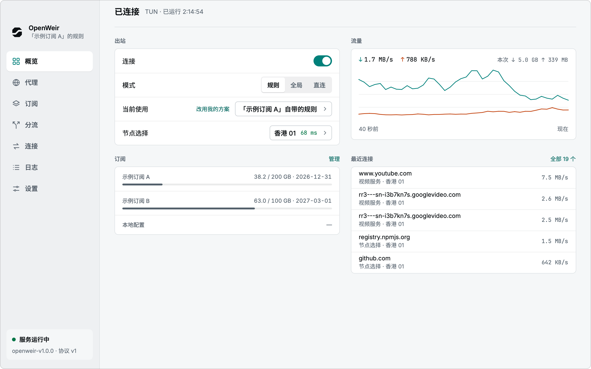
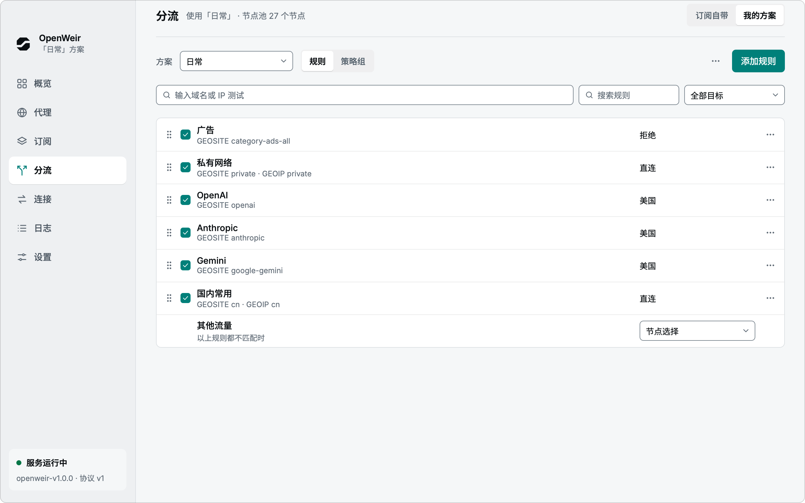
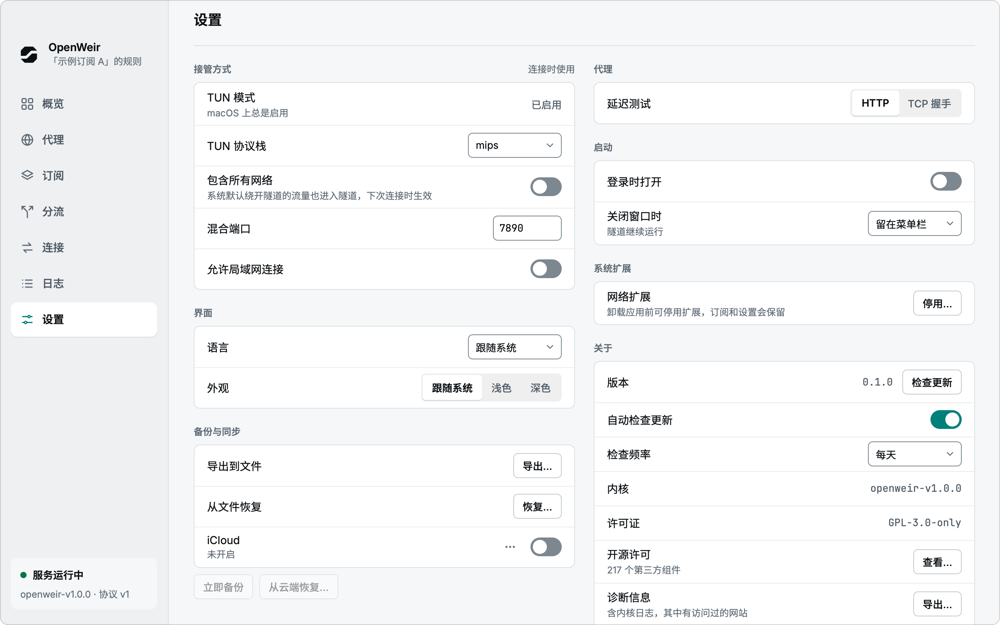

  

<h1 align="center">OpenWeir</h1>

<strong>mihomo, built into the operating system.</strong>

An open-source proxy client for macOS, Windows and Linux, built on each platform's native system architecture.

English · <a href="README.zh-CN.md">简体中文</a>

  <a href="https://github.com/openweir/app-desktop/releases">Download</a> ·
  <a href="#native-system-integration">Features</a> ·
  <a href="docs/usage.md">User guide</a> ·
  <a href="PRIVACY.md">Privacy</a> ·
  <a href="https://github.com/openweir/app-desktop/issues">Report an issue</a> ·
  <a href="docs/development.md">Development</a>

  <picture>
    <source media="(prefers-color-scheme: dark)" srcset="docs/images/overview-dark.png">
    <source media="(prefers-color-scheme: light)" srcset="docs/images/overview-light.png">
    
  </picture>

---

OpenWeir manages your proxy subscriptions, nodes and routing rules. OpenWeir itself has no account and no servers of its own: import your own subscription or configuration and start. If your provider runs an OpenWeir panel, you can also sign in to it and use your account's subscriptions directly; signing in is optional.

The user guide, development and other documents under `docs/` are in Chinese.

## Native system integration

- **Stays connected in the background**: closing the window leaves OpenWeir in the tray or menu bar with the connection running. **Quit OpenWeir** disconnects first, then quits.
- **No administrator rights for daily use**: macOS asks for system extension and VPN approval on the first connection; on Windows the installer registers a background service, and on Linux the package installs a systemd service.
- **Part of the system**: tray controls, open at login, and reconnection after sleep. A connection you turn off stays off.
- **Signed on both platforms**: stable macOS releases are signed with a Developer ID and notarized by Apple, Windows releases are Authenticode-signed, and in-app updates check the installer's signature. Test builds published before the signing certificates were ready are unsigned.

## Connections and routing

- **One switch to connect**: on Windows and Linux choose TUN, the system proxy (on Linux in GNOME and KDE) or both; on macOS a Network Extension takes over traffic. The overview shows the connection state, current mode and live traffic.
- **Subscriptions in one place**: import subscriptions in any common format (mihomo/Clash, sing-box, Xray, share links, Surge, Loon, Shadowrocket, Quantumult X, SIP008), or local configuration files, refresh them on a schedule, and import with one click from `openweir://`, `clash://`, `mihomo://` and `clashmeta://` links. Overrides apply to all subscriptions or to one.
- **Provider accounts (optional)**: sign in to one or more OpenWeir providers, and the subscriptions in your accounts show up next to your others. The Account page shows traffic, expiry, wallet, plans and orders; renewing and paying happen on the provider's website.
- **Use the subscription's rules, or build your own**: pool nodes from several subscriptions, group them by region, create policy groups, and route by service, domain and IP range. The rule tester previews which rule a site will take; routing setups can be imported and exported.
- **Choose and troubleshoot nodes**: switch between rule, global and direct modes, pick policy groups and nodes, run HTTP or TCP handshake latency tests, and view the connection list and core logs.

<picture>
  <source media="(prefers-color-scheme: dark)" srcset="docs/images/routing-dark.png">
  <source media="(prefers-color-scheme: light)" srcset="docs/images/routing-light.png">
  
</picture>

## More network capabilities

OpenWeir uses the [enhanced mihomo](https://github.com/openweir/mihomo) core, which adds to mihomo's protocols:

- **Naive**: HTTP/2, QUIC, and UoT on compatible servers.
- **AnyTLS + REALITY**: AnyTLS nodes that use REALITY.
- **Nowhere NW3**: a Nowhere 3.3 client over TLS or QUIC, forwarding TCP and UDP.

How to configure these nodes, which options need server support, and complete YAML examples are in the [enhanced mihomo guide](docs/mihomo-fork.md).

Traffic can also leave through a **Cloudflare WARP or VPN Gate** chained exit behind the selected node, and you can add **Tailscale, ZeroTier and EasyTier** networks to reach their devices through routing rules.

## Everyday use

- **Fits the desktop**: Simplified Chinese and English, light and dark appearance, tray controls and open at login.
- **Backup and migration**: export local data and choose to replace or merge when restoring; macOS supports iCloud backup. When cloud backup is available is described in the [user guide](docs/usage.md#备份与恢复).
- **In-app updates**: check for a new version, download and verify the installer, and install it once you confirm.
- **Local diagnostics**: view run logs and export diagnostics; raw crash reports are exported only after a separate confirmation and are never uploaded automatically.

<picture>
  <source media="(prefers-color-scheme: dark)" srcset="docs/images/settings-dark.png">
  <source media="(prefers-color-scheme: light)" srcset="docs/images/settings-light.png">
  
</picture>

## Download and install

Get the installers from [GitHub Releases](https://github.com/openweir/app-desktop/releases):

| Platform | Installer |
| --- | --- |
| macOS 26 or later, Apple silicon / Intel x64 | `OpenWeir-<version>-macos-universal.dmg` |
| Windows 10 / 11, x64 | `OpenWeir-<version>-windows-x64-setup.exe` |
| Windows 11, ARM64 | `OpenWeir-<version>-windows-arm64-setup.exe` |
| Linux x64: Ubuntu 22.04, Debian 12, Fedora 41 or later | `OpenWeir-<version>-linux-x64-unsigned.deb` / `.rpm` (previews only for now) |
| Linux arm64: Ubuntu 24.04, Debian 13, Fedora 41 or later | `OpenWeir-<version>-linux-arm64-unsigned.deb` / `.rpm` (previews only for now) |

- **macOS**: open the DMG and drag OpenWeir to Applications; on the first connection, allow the network extension and VPN configuration when asked.
- **Windows**: run the installer and allow administrator access.
- **Linux**: Linux packages are published with the [preview releases](https://github.com/openweir/app-desktop/releases) for now, unsigned: check them against `SHA256SUMS`, then install with `sudo apt install ./OpenWeir-<version>-linux-x64-unsigned.deb` or `sudo dnf install ./OpenWeir-<version>-linux-x64-unsigned.rpm` (`arm64` likewise). The package starts a background service; open OpenWeir from the applications menu. On GNOME the tray icon needs the AppIndicator extension; without a tray, closing the window quits OpenWeir.

Install locations, the SmartScreen prompt, updating and uninstalling are covered in the [user guide](docs/usage.md#安装). Use `SHA256SUMS` to verify the downloads.

## Privacy

OpenWeir collects no usage statistics and never uploads logs or crash reports automatically. Subscriptions, configuration and settings stay on this computer; it only makes the network requests a feature needs, to subscription servers, proxy nodes, the update service, the cloud backup service you choose or the OpenWeir provider you sign in to.

Diagnostic files may contain visited domains, node names or error text, and you decide whether to export and share them. Data storage, cloud backup and third-party services are described in full in the [privacy notice](PRIVACY.md).

## Support and development

- Questions and feature requests: [GitHub Issues](https://github.com/openweir/app-desktop/issues).
- Installing, connecting, backups and common questions: [user guide](docs/usage.md).
- Building from source, running tests and contributing: [development guide](docs/development.md).

## License

OpenWeir is released under [GPL-3.0-only](LICENSE) and uses the [enhanced mihomo](https://github.com/openweir/mihomo) core, based on [mihomo](https://github.com/MetaCubeX/mihomo). Third-party components and their licenses are listed in the app under **Settings › About › Open-source licenses**.

## Acknowledgements

The OpenWeir desktop app is based on [Solaris](https://github.com/openweir/Solaris) (GPL-3.0-only, by Ember Moth), keeps its full commit history and is maintained independently since. Thanks to the authors and contributors of Solaris and mihomo.
