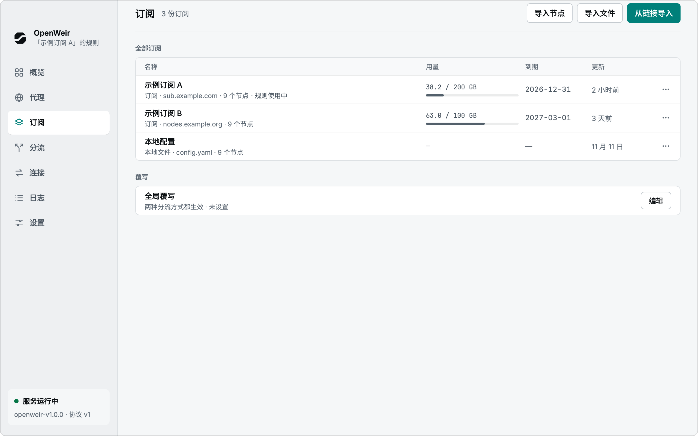
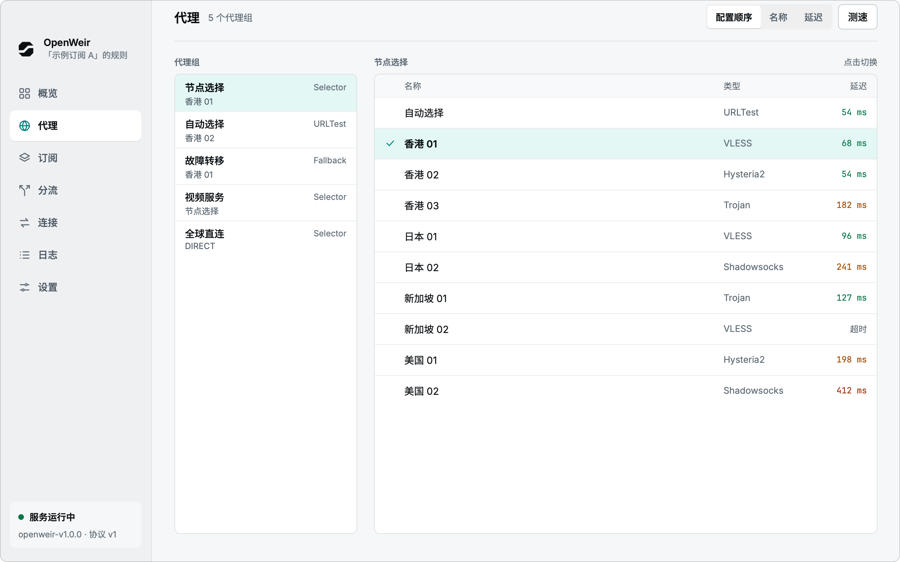
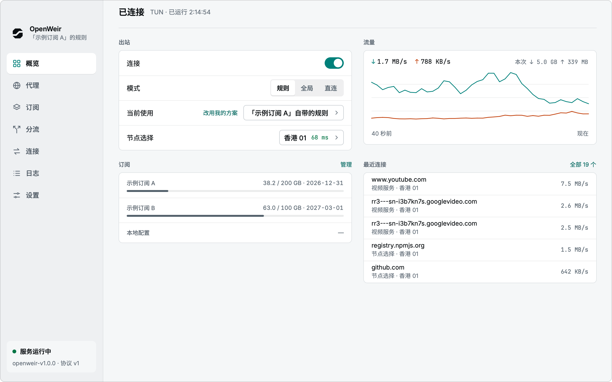
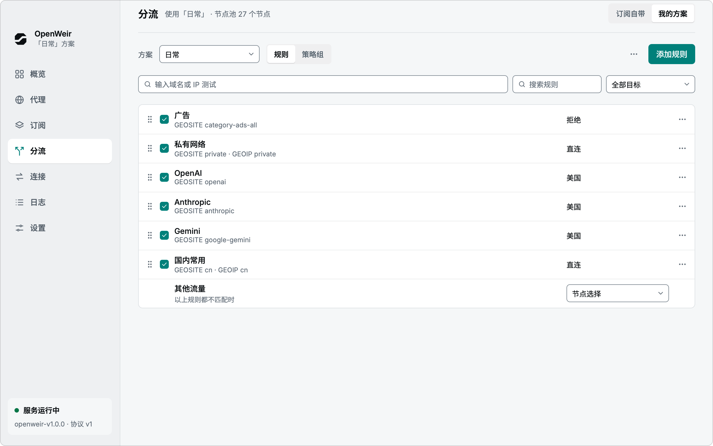
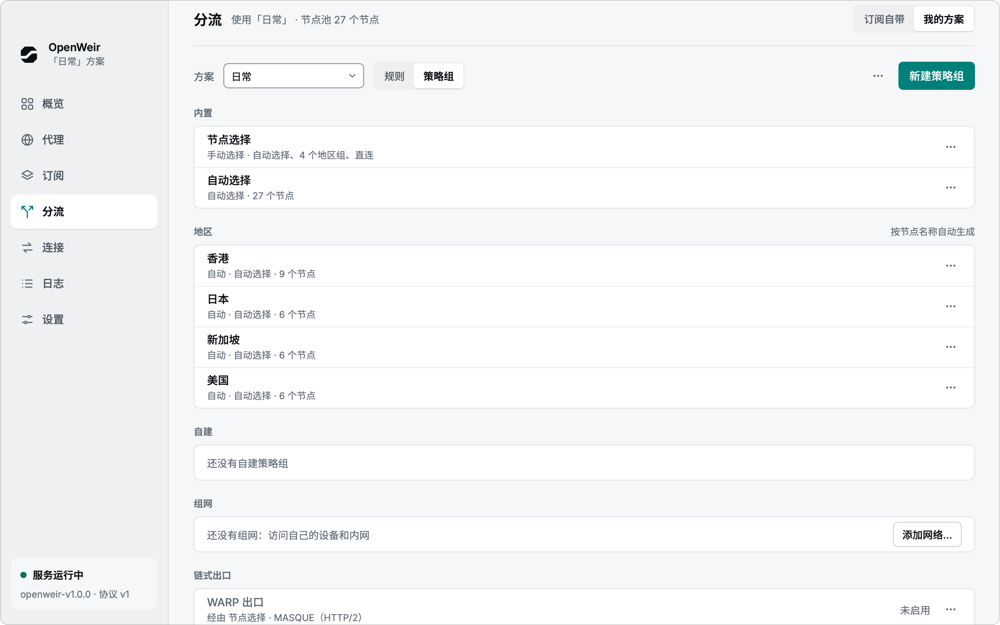
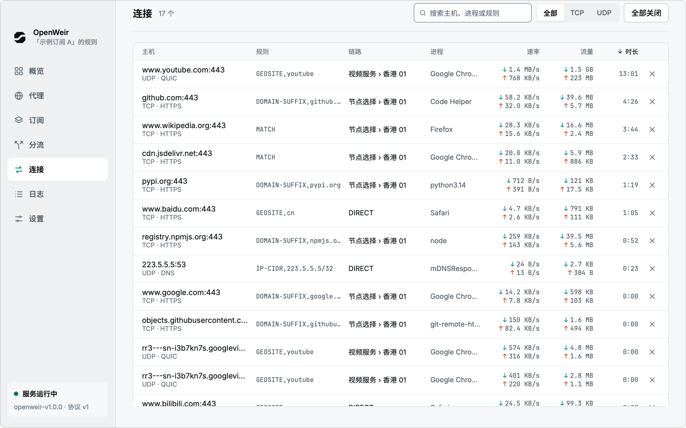
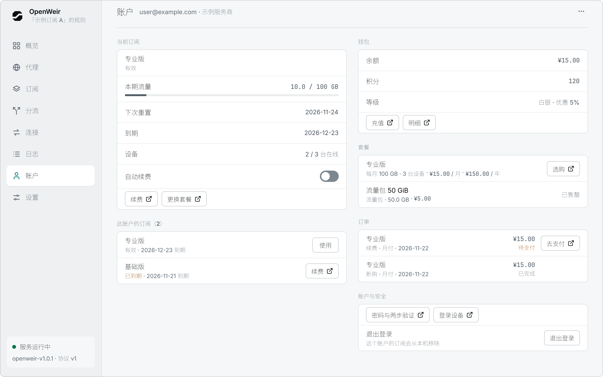
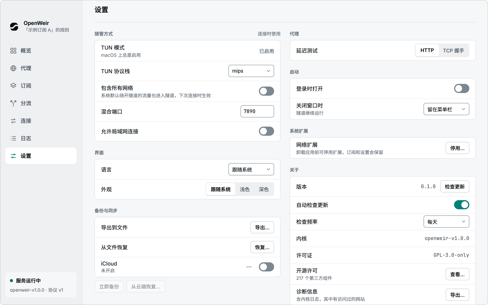

# 使用指南

OpenWeir 管理你导入的代理订阅和 mihomo 配置，本身不提供代理账户或节点。使用 OpenWeir 服务商的，也可以在应用里登录
服务商，直接使用账户里的订阅（见 [服务商账户](#服务商账户)）。

## 安装

从 [GitHub Releases](https://github.com/openweir/app-desktop/releases) 下载适合系统的安装包：

| 系统 | 安装包 |
| --- | --- |
| macOS 26 及以上，Apple Silicon / Intel x64 | `OpenWeir-<版本>-macos-universal.dmg` |
| Windows 10 / 11，x64 | `OpenWeir-<版本>-windows-x64-setup.exe` |
| Windows 11，ARM64 | `OpenWeir-<版本>-windows-arm64-setup.exe` |
| Linux x64：Ubuntu 22.04、Debian 12、Fedora 41 及更新 | `OpenWeir-<版本>-linux-x64-unsigned.deb` / `.rpm`（目前只在预览版里） |
| Linux arm64：Ubuntu 24.04、Debian 13、Fedora 41 及更新 | `OpenWeir-<版本>-linux-arm64-unsigned.deb` / `.rpm`（目前只在预览版里） |

macOS：打开 DMG，将 OpenWeir 拖入「应用程序」。首次连接时按提示允许网络扩展并添加 VPN 配置。

Windows：运行安装程序并允许管理员授权，授权提示里的发布者应是 OpenWeir。首次安装可选择安装位置，
默认是 `C:\Program Files\OpenWeir`。日常使用无需以管理员身份打开 OpenWeir。SmartScreen 若提示「Windows 已保护你的电脑」，
点「更多信息」核对发布者后再运行；发布附件中的 `SHA256SUMS` 可用于核对文件。

Linux：Linux 版目前只随[预览版](https://github.com/openweir/app-desktop/releases)发布，安装包没有签名，先用同一页的
`SHA256SUMS` 核对（`sha256sum --check --ignore-missing SHA256SUMS`），再在下载目录里安装：

```bash
sudo apt install ./OpenWeir-<版本>-linux-x64-unsigned.deb     # Ubuntu、Debian
sudo dnf install ./OpenWeir-<版本>-linux-x64-unsigned.rpm     # Fedora
```

arm64 的机器换成 `arm64` 的包。安装会启用并启动后台服务 `openweir.service`；之后从应用菜单打开 OpenWeir，日常使用无需
`sudo`。只有坐在这台机器前登录的用户能连接（远程登录的不行）。再装同一版本号的预览版时，用
`sudo apt install --reinstall ./…` 或 `sudo dnf reinstall ./…`。

## 第一次连接

1. 在「订阅」中点「添加」：「从链接导入…」导入订阅链接，「导入文件…」导入本地 YAML 配置，「导入节点…」粘贴 VLESS 等
   节点链接（每行一个）；使用 OpenWeir 服务商的，选「登录服务商…」。

   

2. 选择分流方式：使用订阅自带的规则，或把节点加入「我的方案」。
3. 在「代理」中选择节点，可先进行 HTTP 测速。

   

4. 返回「概览」并连接。Windows 和 Linux 可在设置中选择 TUN、系统代理或同时启用（Linux 的系统代理只在 GNOME 和 KDE 上
   可用）；macOS 使用系统 VPN 接管流量。

   

macOS 未连接时，部分导入内容会显示「连接后读取」；连接时会完成读取和校验。
配置错误时，按提示修正后重试。Naive、AnyTLS + REALITY、Snell 和 Nowhere 的示例见 [配置指南](mihomo-fork.md)。

## 分流与节点

订阅行的「更多 → 编辑信息…」可以修改名称、订阅地址和自动更新间隔。导入时也可以设置间隔，单位为小时，
留空时采用服务端建议的间隔，未提供有效建议时为 12 小时。取消勾选「自动更新」即可关闭。本地配置与粘贴的节点也可以改名。
修改订阅地址后，现有配置先保留：开着自动更新时，一分钟内会自动从新地址更新一次；关着时点该行的「更新」即可。
关闭自动更新后再打开，沿用原来设置的间隔。订阅提供的官网和帮助链接可从「编辑信息…」打开。
粘贴的节点保存在本地并随备份保存，不会作为订阅下载或自动更新。

| 模式 | 行为 |
| --- | --- |
| 规则 | 按当前配置或方案的规则选择出口 |
| 全局 | 使用全局策略组选择的出口 |
| 直连 | 直接访问目标 |

「订阅自带」使用所选订阅的策略组与规则；「我的方案」可以汇集多个订阅的节点，按地区组织节点，添加策略组和
服务、域名、IP 段规则。可以先运行规则测试，再结合「连接」页确认实际出口。





HTTP 测速检查请求是否成功；TCP 测速只检查端口连接，不能证明协议认证或 UDP 可用。

游戏、语音通话和 QUIC 使用 UDP。UDP 经过代理需要满足两点：

- 由 TUN 接管。Windows 只开系统代理时，系统代理只对遵循它的应用的 TCP 连接生效，UDP 直接发出。
- 节点支持 UDP。mihomo 节点要写 `udp: true`（Hysteria2、TUIC、WireGuard 本身就走 UDP；Naive 需要
  `udp-over-tcp`），服务端也要支持。当前节点不支持 UDP 时，内核跳过这条规则继续匹配，后面没有规则命中就直连。

可以在「连接」页把网络筛选为 UDP，查看实际链路。



## 服务商账户

服务商部署的是 OpenWeir 面板时，可以在应用里登录它，账户里的订阅直接出现在「订阅」页，不用复制订阅链接。登录是可选的：
OpenWeir 本身没有账户，不登录也照常导入链接、文件和节点。可以同时登录多个服务商，每个服务商一个账户。

**登录**：在「订阅」点「添加 → 登录服务商…」，输入服务商用户中心的网址（如 `https://example.com`），再用邮箱或用户名加
密码、或邮箱验证码登录；开启了两步验证的，再输入身份验证器里的验证码。用户中心里打开 OpenWeir 的链接只会填好地址，
仍由你登录。登录后选择要使用的订阅，也可以点「稍后」；账户只有一份能用的订阅、而你还没有在用的配置时，直接使用它。
服务商要求在网页上完成人机验证、或只支持其他登录方式时，应用里登录不了：在用户中心复制订阅链接，用「添加 → 从链接
导入…」添加。

**订阅页与概览**：服务商的订阅和其他订阅并列，来源写「站点名 · 账户」，用量和到期以服务商为准；需要注意时说明末尾写
状态，如「3 天后到期」「流量已用 92%」「已到期」「需要重新登录」。这些订阅的名称和链接随账户管理，不能改名、复制链接或
单独删除；分流、节点池、覆写和自动更新照常。使用订阅自带的规则时，概览里正在用的订阅快到期或已到期会写「续费」，点它
切到账户页；这份订阅不能用、同一账户里还有能用的时，概览提示「改用「…」」，由你决定是否换用，OpenWeir 不会自动换。

**账户页**：登录后侧栏多一个「账户」，显示当前订阅的流量、下次重置、到期、在线设备和自动续费，账户的全部订阅，以及
钱包、在售的套餐和最近的订单。应用里只能开关自动续费；续费、更换套餐、充值、付款、修改密码和两步验证都在服务商的用户
中心里完成：带外链图标的按钮在浏览器里打开对应的网页，回到 OpenWeir 后自动同步。服务商会缓存几分钟配置，付款后新的
节点可能晚一点出现，可以在「更多 → 刷新」再同步一次。登录了多个服务商时，在标题栏的下拉框里切换。



**需要重新登录**：OpenWeir 运行时会定期同步，登录一直有效；超过 7 天没有打开 OpenWeir，或服务商那边结束了这次登录，
账户就显示「需要重新登录」。这时这个账户的订阅和上次下载的节点都留着，连接照常，只是不再更新；在账户页点「重新登录…」，或在
订阅行的「更多」里选「重新登录…」，登录同一个账户后恢复。服务商停用账户时显示「账户已停用」。

**退出登录**：账户页「账户与安全」里的「退出登录」，或订阅行「更多」里的「退出「站点名」」。退出会从本机移除这个账户的
全部订阅和它们的覆写，确认框里写明移除哪些、之后用谁的规则；服务商那边的订阅和余额不受影响，再次登录后订阅回来。

**备份**：备份里有登录过的服务商的地址、站点名和账户名，没有登录本身。恢复备份或换机后，这些服务商显示「需要重新
登录」，登录同一个账户后，订阅和它们的覆写对上原来的配置。

## 链式出口与组网

在「分流」中配置 WARP 或 VPN Gate 链式出口，选择经由节点，再用规则把指定流量交给该出口。
WARP 需要注册账户，VPN Gate 依赖其志愿者服务器。添加出口本身不会把所有流量切换过去。

也可以添加 Tailscale、ZeroTier 或 EasyTier 网络，完成对应的登录或授权后，为需要访问的设备添加域名或 IP 段规则。
换机后需要重新完成设备授权或填写密钥。

## 关闭窗口、退出与断开

关闭窗口默认把 OpenWeir 留在托盘（macOS 上是菜单栏），连接继续运行。macOS 上窗口关闭后 OpenWeir 不在 Dock 中显示，
从菜单栏图标选「打开主窗口」即可回到窗口。在「设置」里可以把关闭窗口改为「退出 OpenWeir」。

Linux 上要桌面支持托盘图标才有托盘：KDE 自带；GNOME 需要装上 AppIndicator 扩展（Ubuntu 默认装好了，其他发行版的
扩展叫 "AppIndicator and KStatusNotifierItem Support"）。没有托盘时，关闭窗口就会先断开连接再退出 OpenWeir，设置里
「留在托盘」不可选。在 Linux 上按 Ctrl+Q 也是退出 OpenWeir。



从托盘或菜单栏选「退出 OpenWeir」、在 macOS 上按 ⌘Q 或在 Dock 中退出、在 Linux 上按 Ctrl+Q，都会先断开连接，再退出应用。退出后不会自动重连，
包括睡眠唤醒之后；下次打开 OpenWeir 后手动连接。断开失败时会询问重试还是仍然退出；仍然退出时，隧道可能仍在运行。

需要界面运行的自动任务会在退出后暂停，例如订阅和 GEO 数据更新。下次打开时会检查需要处理的更新。

## 备份与恢复

在「设置 → 备份与同步」中导出备份。恢复时可选择替换现有内容或合并，并先查看恢复预览。

- iCloud 仅在 macOS 的签名安装版中可用，需要系统已登录 Apple 账户。
- Google Drive 是否可用以安装包中是否显示该入口为准；可用时通过浏览器登录。
- 云备份保存快照，需要恢复时主动选择一份快照。
- 备份不加密，可能含订阅令牌和配置原文。请妥善保管，勿附在公开问题报告中。
- 应用单独保存的 WARP 账户、组网密钥、Google 登录令牌和服务商的登录不包含在备份中；换机后可能需要重新登录或填写。

完整的数据范围见 [隐私说明](../PRIVACY.md)。

## 更新与卸载

在「设置 → 关于」检查更新。下载安装包并完成校验后，由你确认安装。打开安装包后 OpenWeir 会退出：Windows 上连接由
后台服务保持，升级后自动恢复；macOS 上先断开连接再退出，把新版本拖入「应用程序」替换旧版本后，重新打开并连接。
Windows 升级沿用已有安装位置；Windows on ARM 使用 ARM64 安装包。

Linux 的预览版没有应用内安装：有新版本时「关于」里的按钮打开下载页，下载后像安装时一样用 `sudo apt install` 或
`sudo dnf install` 升级。升级时正在运行的 OpenWeir 会自己退出，连接由后台服务保持，升级后服务重启并恢复连接。

Windows 从「设置 → 应用」卸载，默认保留订阅、设置和日志，也可选择清除。
macOS 卸载前先在 OpenWeir 设置中停用系统扩展，再删除应用。
Linux 用 `sudo apt remove openweir` 或 `sudo dnf remove openweir` 卸载，后台服务一并停止；`sudo apt purge openweir` 再删除
服务保存的数据（`/var/lib/openweir`）。你的订阅和设置在 `~/.local/share/OpenWeir`，卸载时不删除。

## 常见问题

| 现象 | 处理方式 |
| --- | --- |
| macOS 无法连接，提示需要授权 | 按应用提示到系统设置允许网络扩展，确认 VPN 配置，再重试 |
| Windows 提示后台服务不可用 | 使用对应架构的完整安装包重新安装；保留安装器显示的错误，勿仅替换某个 DLL |
| 开着系统代理时 Microsoft Store 等应用打不开 | 这类应用默认不能访问本机回环地址，而系统代理指向本机。在「设置 → 接管方式」保持 TUN 开启、关闭系统代理即可；新安装默认就是这样 |
| 升级提示文件占用或架构不一致 | 关闭正在使用 OpenWeir 文件的程序后重试；仍失败时提交错误信息，不手动混用不同架构的文件 |
| TCP 测速成功，但网页打不开 | 再做 HTTP 测速，检查模式、策略组、规则和节点认证信息 |
| Linux 上设置里「系统代理」不可用 | 系统代理只支持 GNOME 和 KDE；其他桌面使用 TUN 模式，或让程序直接用混合端口 |
| Linux 上提示连接被拒绝、只有在这台机器前的用户能使用 | 从远程登录（SSH、远程桌面）或另一个用户的会话里不能连接；在本机登录的桌面里打开 OpenWeir |
| Linux 上提示后台服务不可用 | 运行 `systemctl status openweir.socket openweir.service` 查看，`sudo systemctl enable --now openweir.socket openweir.service` 重新启用 |
| 游戏或语音通话不经过代理 | Windows、Linux 上开启 TUN 模式；在「连接」页筛选 UDP，链路显示 `DIRECT` 时换用支持 UDP 的节点 |
| 导入后仍使用旧节点 | 确认正在使用该订阅的规则，或已将它加入「我的方案」节点池 |
| 退出后网络仍经代理 | 退出时断开失败并选了仍然退出，或界面意外关闭。重新打开 OpenWeir，使用「断开」停止连接 |
| 没有 Google Drive 入口 | 该安装包未提供此功能；可使用本地备份，macOS 还可使用 iCloud |
| 服务商的订阅显示「需要重新登录」 | 在账户页点「重新登录…」，或在订阅行的「更多」里选它；登录前连接照常，只是这些订阅不再更新 |
| 登录服务商时提示要在网页上完成验证 | 该服务商在应用里登录不了：在用户中心复制订阅链接，用「添加 → 从链接导入…」 |
| 在网页上付款后，账户页没有变化 | 回到 OpenWeir 后会自动同步；仍没变时在账户页「更多 → 刷新」。服务商缓存配置几分钟，新节点可能稍后才出现 |

Tor 出口暂未实现。链式出口和组网功能还需要对应服务或网络的账户、授权与可用连接。

## 反馈问题

在 [GitHub Issues](https://github.com/openweir/app-desktop/issues) 中说明系统与架构、OpenWeir 版本、操作步骤、预期结果
和实际错误。可从「设置 → 关于」导出诊断信息；分享前检查其中的域名、节点名和错误内容。
原始崩溃报告单独导出，不会自动上传。

源码构建、架构和维护流程见 [开发文档](development.md)。
